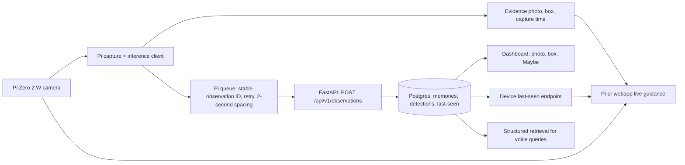

# Raspberry Pi key-memory integration

> **Update (Oct 17):** the demo now runs on a laptop. The wearable streams frames to the RTX 4060 laptop, which runs the
> pipeline and `vision/lastscene_bridge` (it exists in `vision/`) and uploads to the Vercel backend. Pi inference is
> optional and unmeasured. Statements below that say "no laptop bridge" or "the bridge is absent" are outdated.

For the proposed expansion to multiple categories, personal item enrollment, and
quantized Pi inference, see [Personal item enrollment and Raspberry Pi inference](item-enrollment-pi-spec.md).
That specification describes planned work; the keys demo below remains the
existing integration baseline.

This plan maps the supplied `lastscene_bridge` readiness report onto the existing
LastScene backend and dashboard. Repository baseline: `2ad99ab`. Routes and behavior
below were checked in this checkout; deployed behavior and real credentials have
not been verified. There is no laptop bridge and none is planned. The Pi-side
inference/upload client, or a separately deployed server inference worker, is
still a component to build; neither exists in this repository.

## MVP architecture



The Pi-side client or a dedicated server inference worker owns detection and event
selection. The Pi or a webapp live-stream path owns live guidance.
Dylan's service owns authenticated ingestion, household access, persistent evidence,
retrieval and dashboard display. Keep the existing wearable audio path; the bridge
is another device client of the same backend, not a replacement backend.

Only a current camera detection can support "visible now" or live directional
instructions. A backend last-seen photo is historical evidence, not live visibility.
Room recognition is outside the demo: omit `scene` or send `null` when unknown.

## Ready pieces and their integration points

| Piece | Supplied bridge status | Existing repository integration |
|---|---|---|
| Automatic key memories | `m960d`: 4/5 chair-clip runs on clean surfaces; no false memories on the no-keys clip. Saves photo, box and real time. | `backend/app/observations.py` validates and stores automatic observations. These clip results are reported, not reproduced here. |
| Upload | JPEG + JSON, Auth0 token, pairing code, two-second rate limit, retries and offline queue. | `backend/app/routers/observations.py` accepts uploads, detects duplicate IDs and returns 429 for excessive frequency. |
| Where are my keys? | Local `latest_memory()` returns photo, box and time. | `GET /api/v1/items/keys/last-seen` returns evidence and `found_at`; structured labels also enter the existing voice/search retrieval path. |
| Found it | `bridge.found("keys")` clears local key memories and calls the backend. | `POST /api/v1/items/keys/found` marks `found_at`. It does **not** delete server photos/history or hide the last-seen record. |
| Live guidance | `guide()` and `locate()` give box and left/right/up/down cues nearby. | Must run on the Pi or in a webapp live-stream path. No live guidance endpoint or camera loop is supplied by this repository. |
| Tests | 100 passing bridge tests plus real-clip end-to-end tests against a strict local API mock. | Separate from `backend/tests/test_observations*.py`; real backend interoperability still needs a smoke test. |

## Backend contract

All bridge routes use the device's Auth0 M2M bearer token, with the configured
device scope (default `write:memories`). Dashboard access uses its own
user token and household membership.

| Operation | Request | Expected result |
|---|---|---|
| Save memory | `POST /api/v1/observations`, multipart `image` (JPEG) and `observation` (JSON string); `X-Pairing-Code` header | 201 with `memory_id`, `items`, `duplicate: false`; retry of same ID returns 200 and `duplicate: true` |
| Latest keys | `GET /api/v1/items/keys/last-seen` | Photo URL, normalized box, `captured_at`, confidence, `maybe`, optional scene and `found_at`; 404 if absent |
| All latest items | `GET /api/v1/items/last-seen` | `{items: [...]}` |
| Found keys | `POST /api/v1/items/keys/found`, JSON `{}` or `{ "found_at": "<timezone-aware timestamp>" }` | Label and `found_at`; 404 if no sighting exists |
| Undo a false observation | `DELETE /api/v1/observations/{observation_id}` | Deletes this device's observation and rebuilds last-seen from earlier evidence |

Required observation JSON:

- `observation_id`: UUID generated once per event and reused on retries.
- `captured_at`: actual capture timestamp with timezone, preserved during offline
  replay; not upload time. More than five minutes in the future is rejected.
- `source`: `"auto"`.
- `pipeline`: `name` and `version`; optional `detector` and `matcher`. Use actual
  bridge metadata, not fabricated version values.
- `image_size`: positive `width` and `height` matching the uploaded full frame.
- `objects`: one or more objects with `label`, raw `confidence`, normalized
  `[x, y, width, height]` `bbox`, and `event`; optional `track_id`.
- `event`: `placed`, `seen`, `moved` or `picked_up`. Only the first three advance
  last-seen. Do not claim event types the bridge has not detected.
- `scene`: optional; when present requires `id`, with optional `label` and
  `match_score`.

Preserve the JPEG/box coordinate relationship. The backend stores the frame in
`memory_logs`, detections in `memory_detections`, and a separate evidence copy in
`item_last_seen`. It embeds structured item/scene text without a generated photo
caption. Signed photo links expire; fetch last-seen again for a fresh link.
The default observation and last-seen retention is 72 hours.

## Resolve the confidence blocker

The schema accepts confidence from 0 to 1, but the default ingestion filter is
`MIN_DETECTION_CONFIDENCE=0.35`. Objects below it are dropped; if none survive,
the API returns 422. Scores equal to the threshold are accepted.

For the controlled `m960d` demo deployment, set these **backend** environment values:

```dotenv
MIN_DETECTION_CONFIDENCE=0.05
MAYBE_CONFIDENCE=0.5
OBSERVATION_MIN_INTERVAL_SECONDS=2
LAST_SEEN_RETENTION_HOURS=72
```

Restart/redeploy the service after changing its environment. This uses the existing
configuration; no schema change is needed. The minimum applies to **all devices and
labels** in that deployment, not just `m960d` keys. Treat this as the controlled-demo
setting, not a validated general detector threshold. Keep the normal default at
0.35 in the shared example configuration.

Send raw 0.05-0.35 scores without inflating them. With `MAYBE_CONFIDENCE=0.5`, all
these sightings remain uncertain: the dashboard renders a dashed box and "?" / Maybe
label, and retrieval text includes "maybe". Detector scores are not calibrated
probabilities of correctness. The chair and no-keys results do not establish
reliability on cluttered scenes.

## Credentials, pairing and startup

The repository's reference client, `backend/scripts/post_observation.py`, uses
`API_URL`, `AUTH0_DOMAIN`, `AUTH0_AUDIENCE`, `DEVICE_CLIENT_ID`,
`DEVICE_CLIENT_SECRET` and `PAIRING_CODE`. Supply real values privately on the
Pi client; verify the inference client's environment-variable mapping before running
it. These names are verified for the reference client, not for the absent bridge.

1. Dylan confirms the deployed revision includes the observation router, the
   database is initialized, embedding services work and the demo threshold is set.
   These routes already exist in the checkout; deployment is the remaining check.
2. Configure the Pi's device credentials and pairing code. Cache the Auth0
   token until expiry; send the code as `X-Pairing-Code` on upload.
3. Send an accepted observation so the backend learns the pairing code. The
   observation route does not register pairing when all detections are rejected.
4. A household member creates/selects the household and claims the device using its
   Auth0 Client ID and the same pairing code. Verify that household's dashboard
   can see the uploaded evidence. Unclaimed device evidence has device-only scope.
5. From the external bridge environment, run:

   ```bash
   python -m lastscene_bridge.run --source <camera-or-clip> --preset m960d
   ```

Space uploads at least two seconds apart, including offline queue drains. Respect
429 `Retry-After`, retain stable IDs on retries, and preserve capture timestamps.
Surface credential and contract errors instead of retrying 401/403/422 forever.

## Demo sequence and acceptance checks

Use a rehearsed, clean textured surface, keys close to the camera and approximately
two seconds of stable placement. The sequence is Pi camera -> Pi/server inference
-> upload -> dashboard photo and box -> "where are my keys?" -> return with live
guidance -> "found it".

Before calling the integrated demo ready:

- Post a real bridge JPEG/JSON pair at confidence 0.05 and another representative
  score below 0.35. Both must be accepted and displayed as Maybe. A score below
  0.05 must be rejected when it is the only object.
- Verify the dashboard photo, box alignment and original capture time. Confirm
  `GET /api/v1/items/keys/last-seen` returns matching evidence.
- Repeat an observation ID: expect 200 and no duplicate memory. Exercise 429 and
  an offline replay; an older queued sighting must not replace a newer one.
- Ask the question through the intended demo interface. Direct last-seen lookup
  is available; spoken Q&A additionally depends on the existing audio client,
  speech, embeddings, retrieval and answer services. Verify it end to end before
  promising voice interaction.
- Walk back using the Pi camera. Remove keys from view and confirm guidance
  stops claiming visibility rather than reusing the stored box as a live detection.
- Call `bridge.found("keys")`: confirm local deletion and server `found_at`.
  Last-seen consumers must inspect `found_at`; the server still returns the record.
  Check failure/retry behavior if the network drops during found. Also check that
  queued pre-found observations do not unintentionally reopen the item: existing
  last-seen updates clear `found_at` when their capture time is at least as new as
  the stored sighting, even if captured before the found action.
- Replay the no-keys clip and verify no local or backend key memories appear.

The demo excludes cluttered surfaces, distant keys, automatic room recognition
and ESP32 capture. ESP32 is untested; use the Pi camera. Do not describe those
exclusions as working capabilities.

## Remaining integration work

The Pi client/inference owner supplies its runnable package, exact environment mapping and
real evidence fixtures. Dylan supplies the deployed endpoint confirmation,
credentials/pairing setup and demo confidence configuration. Together, run the
acceptance sequence above. Passing a strict mock is useful evidence, but it does
not establish live Auth0, database, dashboard or found/queue interoperability.
